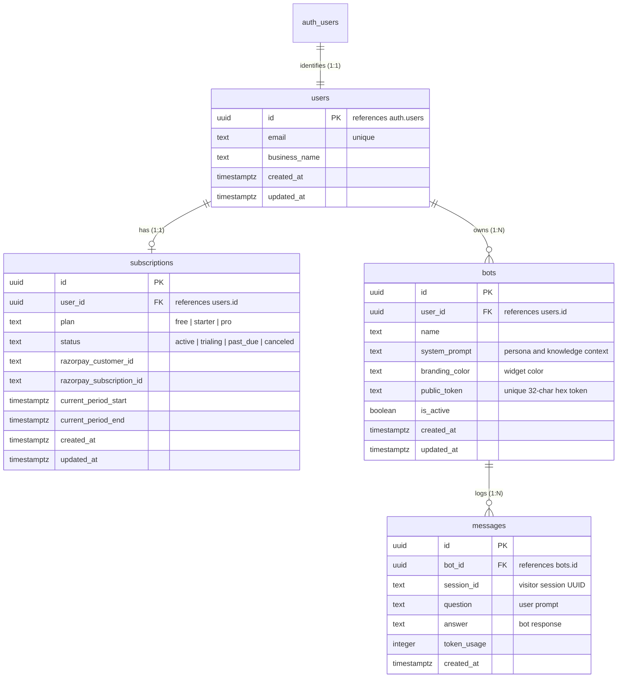

# BizBot SaaS - Project State & Architecture Document

## Overview
**BizBot SaaS** is a multi-tenant AI Chatbot platform that empowers business owners to create, customize, embed, and manage customer-facing AI chatbots trained on their business data. Business owners can sign up, create multiple bots, monitor chat logs and analytics from a unified dashboard, and subscribe to premium plans via Razorpay.

---

## Current Status
**Step 2: Database Schema & Authentication Setup (In Progress / Ready for Schema Execution)**
- [x] Backend initialized with FastAPI, Python venv, dependencies, CORS middleware, and `/health` endpoint.
- [x] Frontend initialized with Next.js (App Router), Tailwind CSS, and TypeScript.
- [x] Supabase project credentials connected:
  - `backend/.env` configured with `SUPABASE_URL` and `SUPABASE_KEY`.
  - `frontend/.env.local` configured with `NEXT_PUBLIC_SUPABASE_URL` and `NEXT_PUBLIC_SUPABASE_ANON_KEY`.
- [x] Full database migration script authored at [schema.sql](file:///C:/Users/Dell-5470/Desktop/Tirth%20work/bizbot-saas/schema.sql) with Razorpay subscription fields and multi-tenant Row Level Security (RLS).
- [x] Frontend Supabase client created at `frontend/src/lib/supabaseClient.ts`.
- [x] Authentication flows built:
  - Signup page (`/signup`): Email, password, and business name.
  - Login page (`/login`): Email and password authentication.
  - Protected Dashboard (`/dashboard`): Restricted to authenticated sessions, greeting with business name & tier, placeholder "Create your first bot" modal, and logout support.
- [x] Build verified: Next.js production build succeeds with all routes compiled cleanly.
- [ ] Next Action: User reviews and executes `schema.sql` in Supabase SQL Editor.

---

## Multi-Tenant Database Schema Design (Supabase / PostgreSQL)

### Table Specifications

#### 1. `users` (Business Accounts / Profiles)
- `id`: `UUID PRIMARY KEY REFERENCES auth.users(id) ON DELETE CASCADE`
- `email`: `TEXT NOT NULL UNIQUE`
- `business_name`: `TEXT`
- `created_at`: `TIMESTAMPTZ DEFAULT timezone('utc'::text, now()) NOT NULL`
- `updated_at`: `TIMESTAMPTZ DEFAULT timezone('utc'::text, now()) NOT NULL`

#### 2. `subscriptions` (Plan Tier & Billing Status - Razorpay)
- `id`: `UUID PRIMARY KEY DEFAULT gen_random_uuid()`
- `user_id`: `UUID NOT NULL REFERENCES public.users(id) ON DELETE CASCADE UNIQUE`
- `plan`: `TEXT NOT NULL DEFAULT 'free' CHECK (plan IN ('free', 'starter', 'pro'))`
- `status`: `TEXT NOT NULL DEFAULT 'active' CHECK (status IN ('active', 'trialing', 'past_due', 'canceled'))`
- `razorpay_customer_id`: `TEXT`
- `razorpay_subscription_id`: `TEXT`
- `current_period_start`: `TIMESTAMPTZ`
- `current_period_end`: `TIMESTAMPTZ`
- `created_at`: `TIMESTAMPTZ DEFAULT timezone('utc'::text, now()) NOT NULL`
- `updated_at`: `TIMESTAMPTZ DEFAULT timezone('utc'::text, now()) NOT NULL`

#### 3. `bots` (Multi-bot Configuration per Business)
- `id`: `UUID PRIMARY KEY DEFAULT gen_random_uuid()`
- `user_id`: `UUID NOT NULL REFERENCES public.users(id) ON DELETE CASCADE`
- `name`: `TEXT NOT NULL`
- `system_prompt`: `TEXT DEFAULT 'You are a helpful customer support assistant for our business.'`
- `branding_color`: `TEXT DEFAULT '#3B82F6'`
- `public_token`: `TEXT UNIQUE NOT NULL DEFAULT encode(gen_random_bytes(16), 'hex')`
- `is_active`: `BOOLEAN DEFAULT true NOT NULL`
- `created_at`: `TIMESTAMPTZ DEFAULT timezone('utc'::text, now()) NOT NULL`
- `updated_at`: `TIMESTAMPTZ DEFAULT timezone('utc'::text, now()) NOT NULL`

#### 4. `messages` (Chat Logs per Bot & Analytics Data)
- `id`: `UUID PRIMARY KEY DEFAULT gen_random_uuid()`
- `bot_id`: `UUID NOT NULL REFERENCES public.bots(id) ON DELETE CASCADE`
- `session_id`: `TEXT NOT NULL`
- `question`: `TEXT NOT NULL`
- `answer`: `TEXT NOT NULL`
- `token_usage`: `INTEGER DEFAULT 0 NOT NULL`
- `created_at`: `TIMESTAMPTZ DEFAULT timezone('utc'::text, now()) NOT NULL`

---

## Row Level Security (RLS) Strategy
- `users`: Only authenticated account holders can SELECT/UPDATE their own record (`auth.uid() = id`).
- `subscriptions`: Only authenticated account holders can SELECT their active plan (`auth.uid() = user_id`).
- `bots`: Business owners have full CRUD access over their bots (`auth.uid() = user_id`). Public anon users can query active bots by `public_token` for chat embeds.
- `messages`: Business owners can view chat history for bots they own (`EXISTS (SELECT 1 FROM bots WHERE bots.id = messages.bot_id AND bots.user_id = auth.uid())`). Visitors can append questions and answers.

---

## Automatic New User Onboarding Trigger
The migration script includes `public.handle_new_user()` executed `AFTER INSERT ON auth.users`:
1. Extracts email and `business_name` from metadata and inserts into `public.users`.
2. Creates an initial active `free` tier record in `public.subscriptions`.
