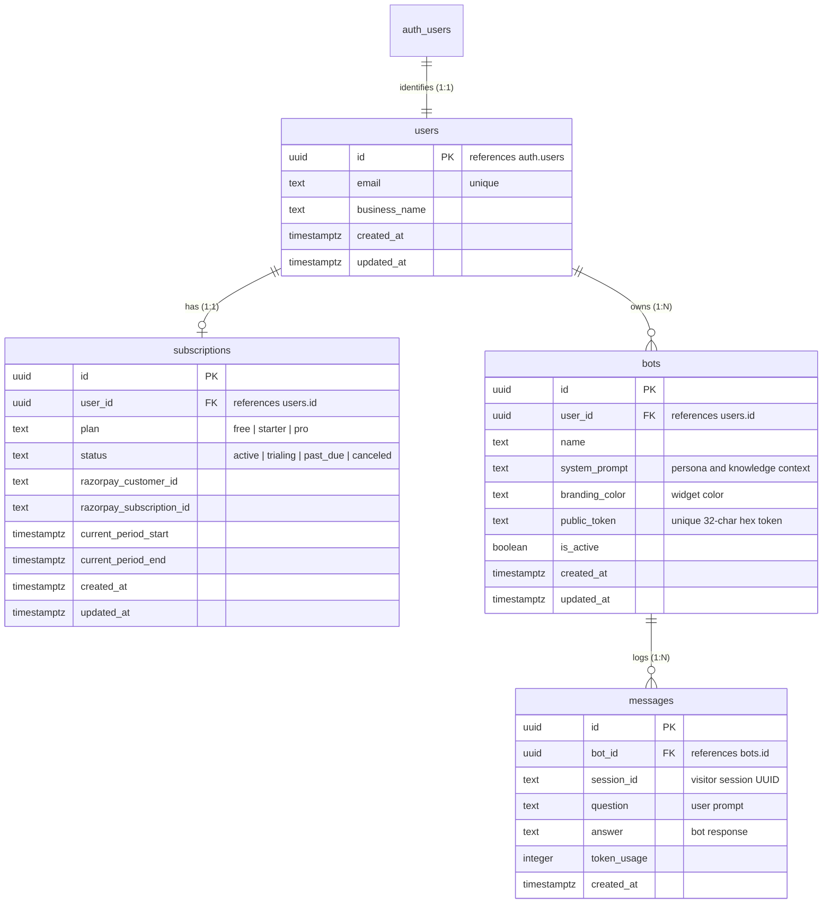

# BizBot SaaS - Project State & Architecture Document

## Overview
**BizBot SaaS** is a multi-tenant AI Chatbot platform that empowers business owners to create, customize, embed, and manage customer-facing AI chatbots trained on their business data. Business owners can sign up, create multiple bots, monitor chat logs and analytics from a unified dashboard, and subscribe to premium plans via Razorpay.

---

## Current Status
**Step 2 Complete: Database Schema Executed & Authentication Operational**
- [x] Backend initialized with FastAPI, Python venv, dependencies, CORS middleware, and `/health` endpoint.
- [x] Frontend initialized with Next.js (App Router), Tailwind CSS, and TypeScript.
- [x] Supabase project credentials connected:
  - `backend/.env` configured with `SUPABASE_URL` and `SUPABASE_KEY`.
  - `frontend/.env.local` configured with `NEXT_PUBLIC_SUPABASE_URL` and `NEXT_PUBLIC_SUPABASE_ANON_KEY`.
- [x] Migration script `schema.sql` successfully executed in Supabase:
  - `public.users`: Business accounts tied to Supabase Auth (`auth.users`).
  - `public.subscriptions`: Razorpay subscription plan tracking (`free`, `starter`, `pro`).
  - `public.bots`: Multi-bot architecture with system prompts, branding colors, and public tokens.
  - `public.messages`: Chat conversation logs, session tracking, and token metrics.
  - `public.handle_new_user()` trigger: Automatically creates business account and default `free` tier subscription upon signup.
  - Multi-tenant Row Level Security (RLS) enabled across all tables.
- [x] Authentication flows built & tested:
  - `/signup`: Business registration (email, password, business name).
  - `/login`: Business owner sign-in.
  - `/dashboard`: Protected route with session check, welcoming the authenticated user, displaying business name and subscription tier, and placeholder for "Create your first bot".
  - Redirect handling: Unauthorized visitors to `/dashboard` are redirected to `/login`.
- [x] Automated test script created at `scripts/test_auth.mjs`.

---

## Multi-Tenant Database Schema Design (Supabase / PostgreSQL)

---

## Next Steps (Step 3: Bot Management & AI Chat Engine)
1. **Bot Studio UI**: Build the bot creation form in `/dashboard` (Bot Name, System Prompt, Custom Business Knowledge base).
2. **FastAPI Chat Endpoint**: Connect Google Gemini 1.5 Flash to generate grounded responses using the bot's custom prompt & knowledge.
3. **Embeddable Chat Widget**: Web component / floating widget for business websites communicating with `/api/chat`.
4. **Analytics View**: Message history, token counts, and visitor sessions display in the dashboard.
