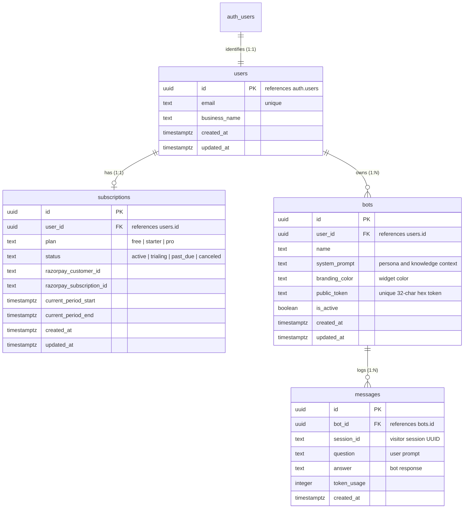

# BizBot SaaS - Project State & Architecture Document

## Overview
**BizBot SaaS** is a multi-tenant AI Chatbot platform that empowers business owners to create, customize, embed, and manage customer-facing AI chatbots trained on their business data. Business owners can sign up, create multiple bots, monitor chat logs and analytics from a unified dashboard, and subscribe to premium plans via Razorpay.

---

## Current Status
**Step 3 Complete: Bot Management Studio & Gemini 3.8 Flash Chat Engine Operational**
- [x] Backend initialized with FastAPI, Python venv, dependencies, CORS middleware, and `/health` endpoint.
- [x] Frontend initialized with Next.js (App Router), Tailwind CSS, and TypeScript.
- [x] Supabase project credentials connected:
  - `backend/.env` configured with `SUPABASE_URL`, `SUPABASE_KEY`, and `GEMINI_API_KEY`.
  - `frontend/.env.local` configured with `NEXT_PUBLIC_SUPABASE_URL` and `NEXT_PUBLIC_SUPABASE_ANON_KEY`.
- [x] Multi-Tenant PostgreSQL Schema (`schema.sql`) live in Supabase:
  - `public.users`: Business accounts tied to Supabase Auth (`auth.users`).
  - `public.subscriptions`: Razorpay subscription plan tracking (`free`, `starter`, `pro`).
  - `public.bots`: Multi-bot architecture with system prompts, branding colors, and public tokens.
  - `public.messages`: Chat conversation logs, session tracking, and token metrics.
  - `public.handle_new_user()` trigger: Automatically creates business account and default `free` tier subscription upon signup.
  - Row Level Security (RLS) active across all tables.
- [x] Authentication & Dashboard:
  - `/signup`: Business registration (email, password, business name).
  - `/login`: Business owner sign-in.
  - `/dashboard`: Protected route with session check, displaying business name, active bots, plan tier, and bot management studio.
- [x] Bot Studio & Chat Engine:
  - Bot Creator modal in dashboard with custom name, color picker presets, and business knowledge base text area.
  - Active/Paused status toggles and delete controls.
  - Backend `GET /api/bot/{public_token}`: Serves public bot configuration for client widgets.
  - Backend `POST /api/chat`: Grounded AI generation powered by Google Gemini 3.8 Flash, strict knowledge grounding, and automatic asynchronous logging to `messages` table.
  - Public & Embeddable Chat Widget (`/chat/[token]`): Responsive chat page customized with bot branding color, conversational state, and copyable `<iframe>` embed snippet.
  - Conversation Analytics Drawer: View real-time user query history, bot responses, timestamps, and token usage.

---

## Multi-Tenant Database Schema Design (Supabase / PostgreSQL)

---

## Roadmap & Next Steps (Step 4: Subscriptions & Billing with Razorpay)
1. **Plan Tiers & Quota Enforcement**:
   - Free: 1 bot, up to 100 messages/month.
   - Starter: 3 bots, up to 2,000 messages/month, custom branding.
   - Pro: Unlimited bots, 15,000 messages/month, priority Gemini models.
2. **Razorpay Integration**:
   - Subscriptions checkout button in dashboard.
   - Webhook endpoint in FastAPI to update `public.subscriptions` on successful payment.
