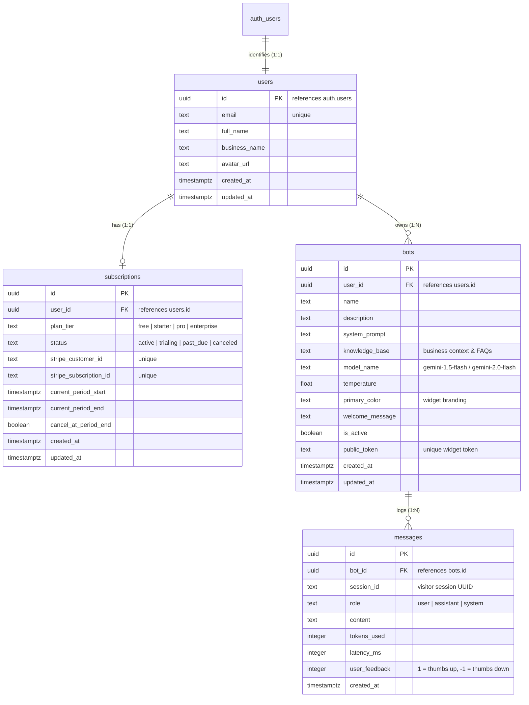

# BizBot SaaS - Project State & Architecture Document

## Overview
**BizBot SaaS** is a multi-tenant AI Chatbot platform that empowers business owners to create, customize, embed, and manage customer-facing AI chatbots trained on their business data. Business owners can sign up, create multiple bots, monitor chat logs and analytics from a unified dashboard, and subscribe to premium plans via Stripe.

---

## Current Status
**Step 1 complete: skeleton created.**
- [x] Backend initialized with FastAPI, Python venv, dependencies, CORS middleware, and `/health` endpoint.
- [x] Frontend initialized with Next.js (App Router), Tailwind CSS, and TypeScript.
- [x] Schema & architectural design documented in `PROJECT_STATE.md`.
- [x] Local verification: Backend `/health` operational, Next.js frontend serving successfully.
- [x] Repository initialized with `.gitignore` and published to GitHub under `tirthm2538-beep/bizbot-saas`.

---

## Multi-Tenant Database Schema Design (Supabase / PostgreSQL)

The database schema is designed for multi-tenancy, strict data isolation via PostgreSQL Row Level Security (RLS), and seamless integration with Supabase Auth (`auth.users`).

### Table Definitions & Specifications

#### 1. `users` (Business Accounts / Profiles)
Stores business owner account metadata linked directly to Supabase Auth (`auth.users`).
- `id`: `UUID PRIMARY KEY REFERENCES auth.users(id) ON DELETE CASCADE`
- `email`: `TEXT NOT NULL UNIQUE`
- `full_name`: `TEXT`
- `business_name`: `TEXT`
- `avatar_url`: `TEXT`
- `created_at`: `TIMESTAMPTZ DEFAULT now() NOT NULL`
- `updated_at`: `TIMESTAMPTZ DEFAULT now() NOT NULL`

*RLS Policies:*
- Users can view and update only their own profile (`auth.uid() = id`).

#### 2. `subscriptions` (Plan Tier & Billing Status)
Tracks customer subscription tier, status, and Stripe identifiers.
- `id`: `UUID PRIMARY KEY DEFAULT gen_random_uuid()`
- `user_id`: `UUID NOT NULL REFERENCES users(id) ON DELETE CASCADE UNIQUE`
- `plan_tier`: `TEXT NOT NULL DEFAULT 'free'` (`free`, `starter`, `pro`, `enterprise`)
- `status`: `TEXT NOT NULL DEFAULT 'active'` (`active`, `trialing`, `past_due`, `canceled`, `unpaid`)
- `stripe_customer_id`: `TEXT UNIQUE`
- `stripe_subscription_id`: `TEXT UNIQUE`
- `current_period_start`: `TIMESTAMPTZ`
- `current_period_end`: `TIMESTAMPTZ`
- `cancel_at_period_end`: `BOOLEAN DEFAULT false NOT NULL`
- `created_at`: `TIMESTAMPTZ DEFAULT now() NOT NULL`
- `updated_at`: `TIMESTAMPTZ DEFAULT now() NOT NULL`

*RLS Policies:*
- Users can read their own subscription record (`auth.uid() = user_id`).
- Updates managed via service role (Stripe webhooks backend).

#### 3. `bots` (Multi-bot Configuration per Business)
Each business user can create and configure multiple bots with distinct knowledge bases, branding, and system prompts.
- `id`: `UUID PRIMARY KEY DEFAULT gen_random_uuid()`
- `user_id`: `UUID NOT NULL REFERENCES users(id) ON DELETE CASCADE`
- `name`: `TEXT NOT NULL`
- `description`: `TEXT`
- `system_prompt`: `TEXT DEFAULT 'You are a helpful customer support assistant.'`
- `knowledge_base`: `TEXT` (raw business context, FAQs, product info)
- `model_name`: `TEXT DEFAULT 'gemini-1.5-flash'`
- `temperature`: `FLOAT DEFAULT 0.7`
- `primary_color`: `TEXT DEFAULT '#3B82F6'`
- `welcome_message`: `TEXT DEFAULT 'Hello! How can I assist you today?'`
- `is_active`: `BOOLEAN DEFAULT true NOT NULL`
- `public_token`: `TEXT UNIQUE NOT NULL DEFAULT encode(gen_random_bytes(16), 'hex')`
- `created_at`: `TIMESTAMPTZ DEFAULT now() NOT NULL`
- `updated_at`: `TIMESTAMPTZ DEFAULT now() NOT NULL`

*RLS Policies:*
- Owners can SELECT, INSERT, UPDATE, DELETE their own bots (`auth.uid() = user_id`).
- Public read-only policy for active bot public metadata via `public_token` (for client embed widgets).

#### 4. `messages` (Chat Logs per Bot & Analytics Data)
Stores conversational history between visitors and bots for analytics, audit logs, and feedback loops.
- `id`: `UUID PRIMARY KEY DEFAULT gen_random_uuid()`
- `bot_id`: `UUID NOT NULL REFERENCES bots(id) ON DELETE CASCADE`
- `session_id`: `TEXT NOT NULL` (client visitor session)
- `role`: `TEXT NOT NULL` (`user`, `assistant`, `system`)
- `content`: `TEXT NOT NULL`
- `tokens_used`: `INTEGER DEFAULT 0`
- `latency_ms`: `INTEGER DEFAULT 0`
- `user_feedback`: `INTEGER DEFAULT NULL` (+1 for thumbs up, -1 for thumbs down)
- `created_at`: `TIMESTAMPTZ DEFAULT now() NOT NULL`

*RLS Policies:*
- Bot owners can view all messages for bots they own (`EXISTS (SELECT 1 FROM bots WHERE bots.id = messages.bot_id AND bots.user_id = auth.uid())`).
- Service role or backend API endpoint writes messages during active visitor conversations.

---

## Full End-to-End Implementation Plan

### Phase 1: Accounts & Multi-Tenant Authentication
1. **Supabase Auth Integration**:
   - Next.js `@supabase/ssr` / `@supabase/auth-helpers-nextjs` client and server utilities.
   - Signup, Login, Password Reset, and Magic Link authentication flows.
   - Auto-create user profile row in `users` table via Supabase Database Webhook / Trigger on `auth.users` insert.
2. **Session & Protected Routes**:
   - Next.js middleware protecting `/dashboard/*` routes.
   - User profile dropdown, organization/business switcher, and account settings.

### Phase 2: Dashboard & Bot Management
1. **Bot Studio**:
   - List all bots owned by the logged-in business account with status indicators.
   - Create new bot wizard (Name, Persona, System Prompt, Initial Knowledge Base).
   - Knowledge Base management (upload text/documents/FAQs with parsing).
2. **Branding & Customization**:
   - Color picker, avatar selection, widget position, and custom greeting messages.
3. **Embeddable Widget & Preview Playground**:
   - Interactive live playground in dashboard to test bots instantly.
   - Generated `<script>` tag snippet and shareable public URL (`/chat/[public_token]`).

### Phase 3: High-Performance Chat Engine & Analytics
1. **Backend Chat Pipeline**:
   - FastAPI `/api/v1/chat` endpoint utilizing Google Gemini API with system prompt injection + knowledge grounding.
   - Streaming responses (Server-Sent Events) for fast TTFT (Time-to-First-Token).
   - Visitor session tracking and asynchronous message logging to Supabase.
2. **Business Analytics Dashboard**:
   - Total conversations & message volume over time.
   - Top recurring user questions and unanswered queries.
   - Visitor satisfaction rating (% positive vs. negative feedback).
   - Estimated token consumption and usage against plan quota.

### Phase 4: Subscriptions, Quotas & Payments
1. **Stripe Integration**:
   - Tiered plans:
     - **Free**: 1 bot, up to 100 messages/month.
     - **Starter ($29/mo)**: 3 bots, 2,000 messages/month, custom branding.
     - **Pro ($79/mo)**: Unlimited bots, 15,000 messages/month, priority Gemini models, removal of "Powered by BizBot" badge.
   - Stripe Checkout session creation for upgrades.
   - Stripe Customer Portal for managing payment methods and cancelations.
   - Webhook listener in FastAPI (`/api/v1/webhooks/stripe`) to synchronize subscription state into Supabase.

---

## Tech Stack Summary
- **Frontend**: Next.js 15+ (App Router), TypeScript, Tailwind CSS, Lucide Icons.
- **Backend**: FastAPI (Python 3.12), Uvicorn, Pydantic v2, Google Generative AI SDK, Supabase Python Client.
- **Database & Auth**: Supabase (PostgreSQL 15+, Row Level Security, Supabase Auth).
- **Payments**: Stripe API & Webhooks.
- **Deployment Target**: Vercel (Frontend), Render / Railway / Cloud Run (FastAPI Backend), Supabase Cloud (PostgreSQL & Auth).
